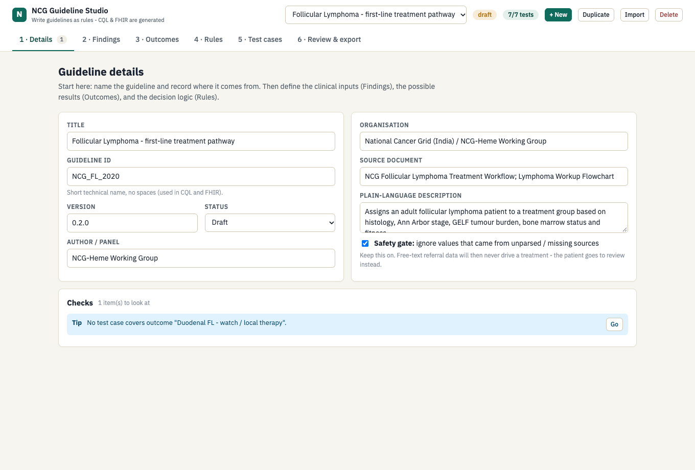
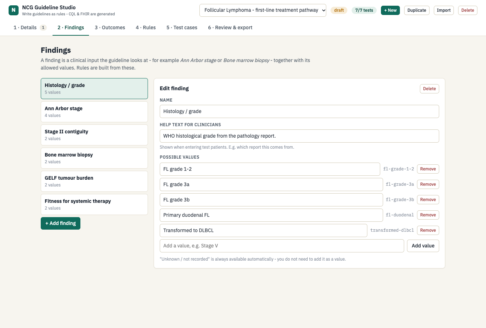
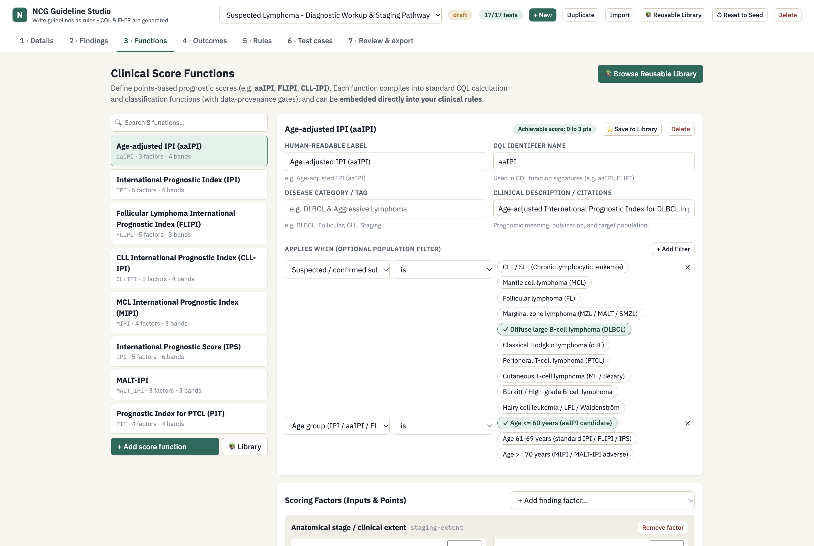
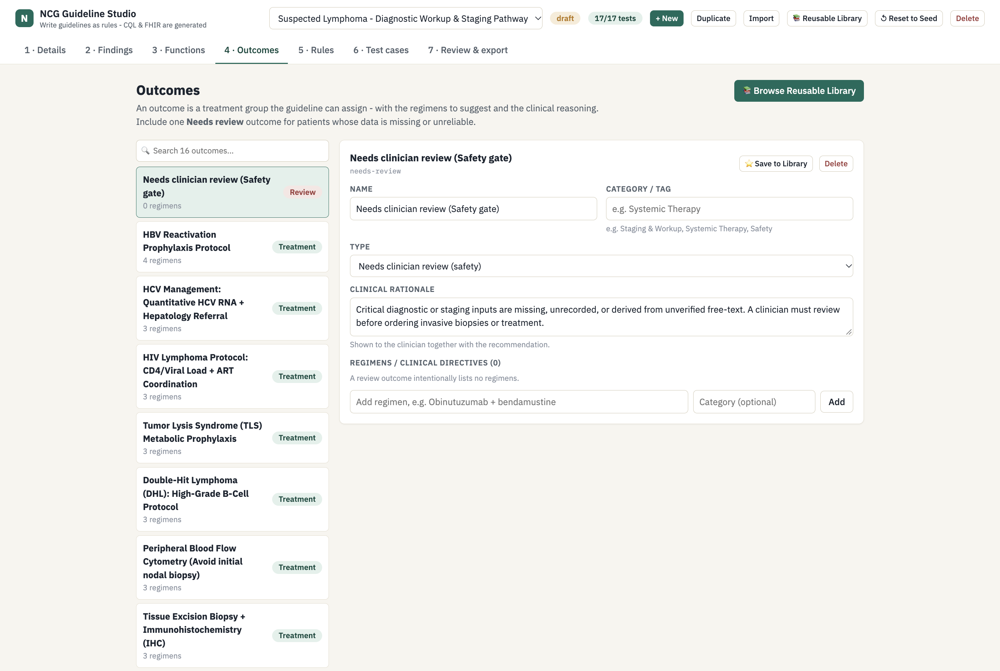
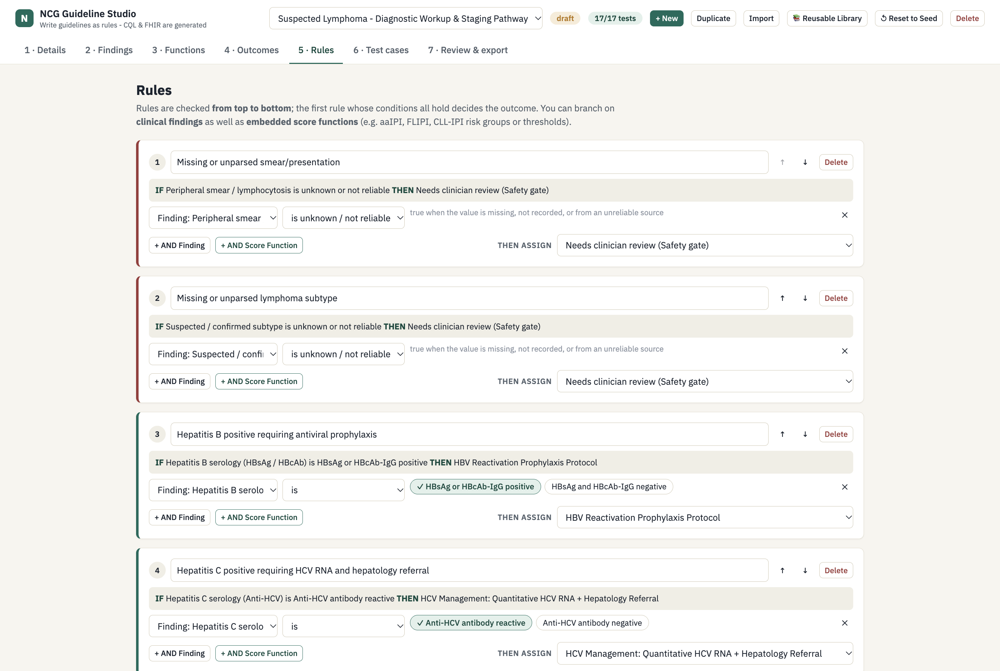
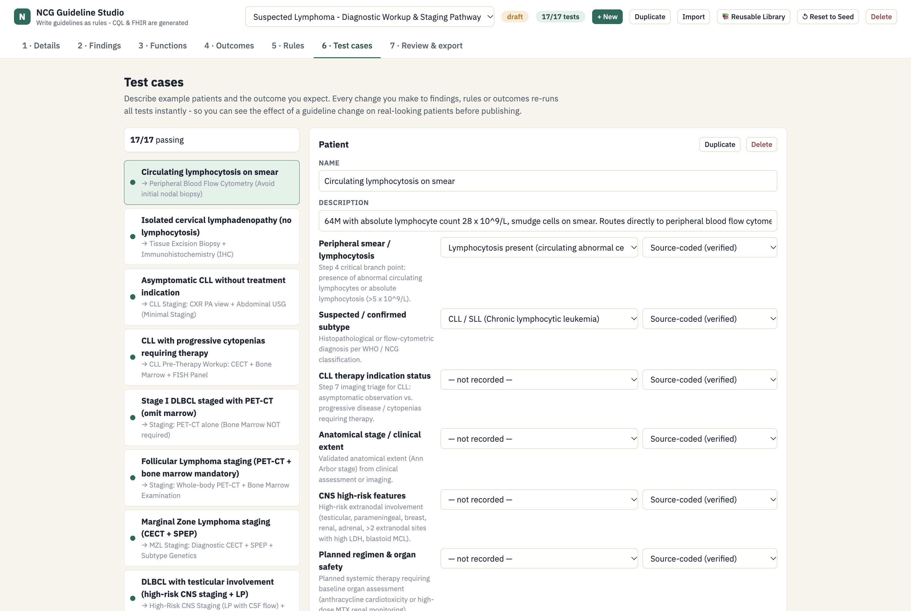
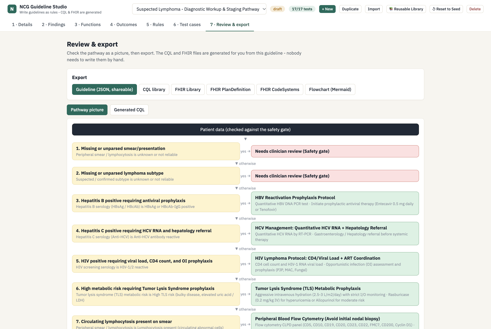
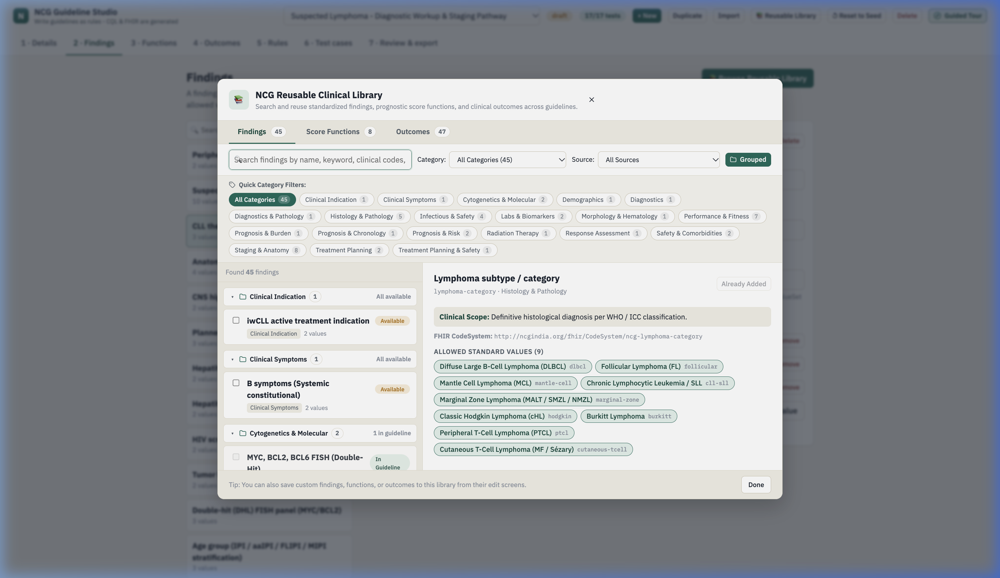
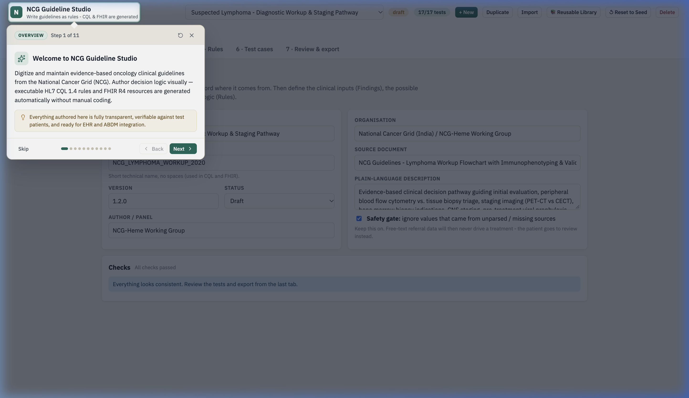
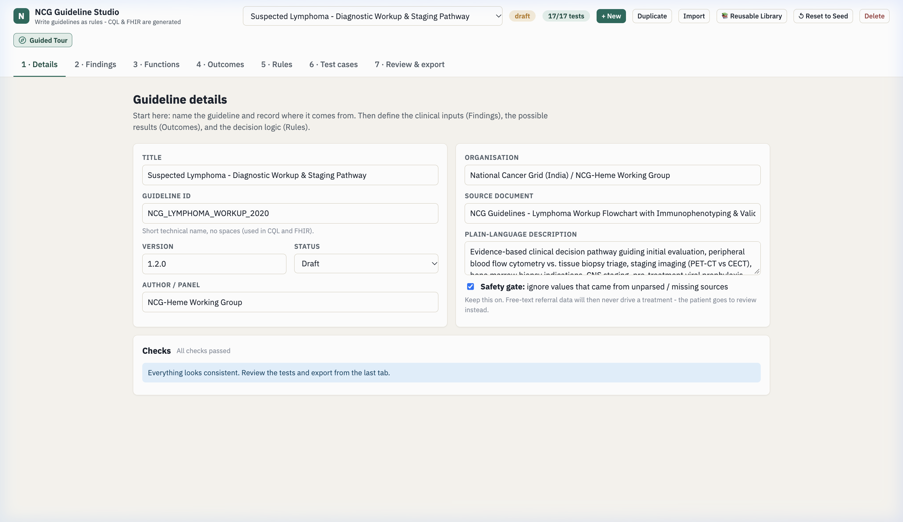

# NCG Guideline Studio (v2) — No-Code Clinical Pathway Authoring

A standalone web authoring environment designed specifically for **medical experts, oncologists, and guideline panels** to create, edit, test, and publish executable, standards-compliant ([HL7 CQL](https://cql.hl7.org/) and [HL7 FHIR](https://hl7.org/fhir/R4/)) clinical practice guidelines **without writing any code**.

The clinical author defines findings, prognostic score functions, treatment outcomes, and decision rules in plain clinical language. The studio automatically generates:
1. **Spec-compliant CQL 1.4 logic libraries** (with automatic data-provenance gates and pure mathematical functions).
2. **FHIR R4 PlanDefinitions and Libraries** ready for EHR Clinical Decision Support ([CDS Hooks](https://cds-hooks.hl7.org/)).
3. **FHIR R4 CodeSystems and ValueSets** for standard terminology mapping.
4. **Interactive Mermaid decision flowcharts** for visual consensus reviews.
5. **Portable Guideline JSON packages** for cross-institution sharing and revision tracking.

---

## Authoring Workflow & Studio Tour

```
┌───────────┐   ┌────────────┐   ┌─────────────┐   ┌────────────┐   ┌─────────┐   ┌────────────┐   ┌─────────────────┐
│ 1 Details │ → │ 2 Findings │ → │ 3 Functions │ → │ 4 Outcomes │ → │ 5 Rules │ → │ 6 Patients │ → │ 7 Export & CQL │
└───────────┘   └────────────┘   └─────────────┘   └────────────┘   └─────────┘   └────────────┘   └─────────────────┘
```

The studio guides guideline panels through 7 clinical authoring stages:

### 1 · Details & Clinical Safety Gate
Define the guideline identity, managing oncology working group, citations, and version. The built-in **Data Provenance Safety Gate** can be toggled to automatically guarantee that unvalidated free-text referral data is routed to clinician review instead of inadvertently triggering cytotoxic systemic therapy.



---

### 2 · Clinical Findings & Search
Specify clinical input parameters (e.g. *Anatomical stage*, *Serum LDH*, *ECOG PS*, *Bone marrow biopsy*, *Hepatitis serology*) and configure allowed values with clinical guidance notes and FHIR CodeSystem URIs.
- **In-Page Search:** Instantly filter dozens of findings by name, code, or value.
- **Category Tags:** Categorize findings into *Staging & Anatomy*, *Labs & Biomarkers*, *Histology & Pathology*, *Safety & Comorbidities*, etc.
- **Save to Library:** Export custom findings directly into the reusable clinical library.



---

### 3 · Clinical Score Functions (aaIPI, IPI, FLIPI, CLL-IPI...)
Define points-based prognostic indices used in clinical staging and risk stratification:
- **Factor Point Allocation:** Assign points to discrete finding values (e.g. `Stage III-IV (+1)`, `Serum LDH elevated (+1)`, `ECOG PS >= 2 (+1)`).
- **Dynamic Score Range:** Live computation of achievable score totals (e.g. `0 to 3 pts`).
- **Risk Stratification Bands:** Configure cutoff score thresholds, codes, and survival prognosis notes.
- **Population Applicability Filter:** Enforce target demographics (e.g. *aaIPI applies only to DLBCL patients age <= 60*).
- **Spec-Compliant CQL Generation:** Automatically emits pure parameter-driven functions (`Calculate_<Name>` and `Classify_<Name>`) alongside patient-level definitions (`<Name>_Score`, `<Name>_RiskGroup`, `<Name>_RiskLabel`) with data-provenance gates.



---

### 4 · Treatment Outcomes & Regimens
Create actionable clinical pathways categorized into **Treatment Recommendation**, **Observation / Watchful Waiting**, or **Needs Clinician Review (Safety Gate)**. Attach regimen shortlists (e.g. *R-CHOP x 6*, *Bendamustine + Rituximab*, *Polatuzumab + R-CHP*, *ISRT 24 Gy*) and explicit clinical rationales.



---

### 5 · Visual Decision Rules (Top-to-Bottom Ladder)
Construct hierarchical clinical decision logic using an intuitive visual **IF ... THEN ...** rule builder. Rules evaluate top-to-bottom so that safety caveats, viral reactivation precautions, and high-risk variants execute before broad standard pathways.
- **Finding Conditions:** Branch on any clinical finding (`is`, `is not`, `is unknown / not reliable`).
- **Embedded Score Functions:** Directly embed prognostic score conditions into rule logic using:
  - `score is at least` (e.g. *aaIPI score >= 2*)
  - `score is at most` (e.g. *aaIPI score <= 1*)
  - `risk group is` (e.g. *FLIPI risk group is High Risk*)
  - `cannot be calculated` (e.g. *prognostic score unknown due to missing or unparsed labs*)



---

### 6 · Patient Test Bench & Live Verification
Define representative synthetic patient cases (e.g. *Stage I limited*, *High aaIPI advanced DLBCL*, *Unparsed LDH referral text*, *Hepatitis B positive*, *Double-Hit lymphoma*) and verify evaluations in real time:
- **Instant Rule Tracing:** Visual tick/cross indicators show every rule evaluated, matching conditions, and the decisive winning branch.
- **Calculated Score Functions Card:** Factor-by-factor breakdown showing points awarded for each clinical observation, total calculated score, and resulting risk band.
- **Safety Provenance Verification:** Confirms that unparsed referral text safely yields a `null` score, causing high-risk intensified rules to defer to clinician review.



---

### 7 · Review & Multi-Standard Export
Inspect the generated visual decision ladder and export standard-compliant clinical artifacts with a single click:
* **Guideline (JSON, shareable)** — Portable document for version control and peer exchange.
* **CQL Library (v1.4)** — Spec-compliant HL7 CQL with automated data-provenance gates and pure mathematical functions.
* **FHIR Library & PlanDefinition** — HL7 FHIR R4 resources ready for CDS Hooks engines.
* **FHIR CodeSystems & ValueSets** — Standardized terminologies for EHR mapping.
* **Flowchart (Mermaid)** — Visual pathway diagram for clinical review.



---

## Cross-Guideline Reusable Clinical Catalog & Search Engine

To prevent guideline panels from redefining identical findings, scores, and regimens across multiple disease pathways, the studio features a unified **Reusable Clinical Library**:



### Key Features of the Catalog:
1. **Multi-Source Knowledge Pool:**
   - **NCG Standard Catalog:** 27 pre-built clinical findings, 8 prognostic score functions, and 17 standardized outcomes curated from NCG protocols.
   - **Cross-Guideline Discovery:** Automatically indexes findings, scores, and outcomes from all other guidelines loaded in the studio (e.g. import from *Lymphoma Workup* into *Follicular Lymphoma* or *CLL*).
   - **User Custom Library:** Any custom-authored item can be saved with **`⭐ Save to Library`** to persist across all guidelines.
2. **Instant Search & Category Filters:**
   - Multi-field search across titles, IDs, clinical descriptions, allowed values, regimens, and citations.
   - Category filter pills (*Staging & Anatomy*, *Labs & Biomarkers*, *Cytogenetics & Molecular*, *Infectious & Safety*, *Systemic Therapy*, etc.).
3. **Automatic Dependency Resolution for Score Functions:**
   - When importing a score function (e.g. `aaIPI` or `FLIPI`), the catalog automatically inspects the target guideline to identify whether required factor findings exist.
   - If findings are missing (e.g. `serum-ldh`, `staging-extent`), the modal offers a 1-click **"Auto-import missing findings"** option, ensuring the function is immediately usable without broken references.
4. **Single & Bulk Import:** Checkboxes enable selecting multiple items for 1-click bulk import.

---

## Interactive Guided Tour (Replayable On-Demand)

To help clinicians, informatics specialists, and new guideline authors get up to speed quickly, the studio features a built-in **Interactive Guided Tour**:



### Key Features of the Guided Tour:
1. **Always Accessible & Replayable:**
   - A dedicated **`🧭 Guided Tour`** button in the header bar allows users to replay the entire tour from Step 1 on demand at any time.
   - For first-time visitors, a gentle welcome banner highlights the 2-minute tour with 1-click launch or dismiss options.
   - At the final step, a prominent **`↺ Replay Tour`** action allows instant repetition.
   - A quick-restart icon (`↺`) in the popover header lets authors rewind to Step 1 from any point in the walkthrough.

2. **Automated Tab Switching & In-Context Highlighting:**
   - As the tour steps from *Setup* → *Findings* → *Functions* → *Outcomes* → *Rules* → *Test cases* → *Review & export*, the studio **automatically switches the active tab** so users see the actual live authoring interface in context.
   - An SVG spotlight cutout mask focuses on the target UI element with an animated accent glow while dimming the surrounding background.



3. **Step Navigation & Keyboard Shortcuts:**
   - **Clickable Step Dots:** Click any of the 11 step dots in the footer to jump directly to that authoring phase.
   - **Keyboard Navigation:** Navigate with `Arrow Right` (Next), `Arrow Left` (Previous), and `Escape` (Exit).
   - **Clinical Tips & Guidance:** Each step includes practical oncology authoring tips explaining terminology bindings, CQL mathematical function compilation, and EHR safety gates.


---


## Pre-loaded Clinical Guidelines

1. **Suspected Lymphoma — Diagnostic Workup & Staging Pathway** (`NCG_LYMPHOMA_WORKUP_2020`)
   - **Source:** NCG Lymphoma Workup Flowchart ([`ncg-guidelines/Lymphoma_Workup_Flowchart.docx.pdf`](../ncg-guidelines/Lymphoma_Workup_Flowchart.docx.pdf))
   - **Workflow:** Implements complete diagnostic triage:
     - Smear lymphocytosis triage (Flow cytometry CLPD panel vs. tissue excision biopsy).
     - Subtype-specific imaging (PET-CT for aggressive/indolent vs. CXR+USG for asymptomatic CLL vs. CECT for MZL & cutaneous T-cell).
     - Bone marrow biopsy necessity (mandatory for FL/MCL/Burkitt; omitted in limited Stage I–II DLBCL and PET-CT staged Hodgkin lymphoma).
     - Infectious & metabolic safety gates (HBV, HCV, HIV, TLS metabolic prophylaxis, DTPA GFR for high-dose MTX).
     - Disease-specific prognostic scores: `aaIPI`, `IPI`, `FLIPI`, `MIPI`, `CLL-IPI`, `IPS`, `MALT-IPI`, `PIT`.
     - Rule 18 gates treatment planning directly on `aaIPI >= 2`.
   - **Test Suite:** 17/17 automated synthetic patient scenarios passing 100%.
   - **Direct link:** [http://localhost:5173/?guideline=NCG_LYMPHOMA_WORKUP_2020](http://localhost:5173/?guideline=NCG_LYMPHOMA_WORKUP_2020)

2. **Follicular Lymphoma — First-Line Treatment Pathway** (`NCG_FL_2020`)
   - **Source:** NCG Follicular Lymphoma Treatment Workflow
   - **Workflow:** GELF tumour burden, Ann Arbor staging, bone marrow involvement, and fitness stratification into curative radiotherapy, watchful waiting, or chemoimmunotherapy (BR / R-CHOP).
   - **Test Suite:** 7/7 automated test cases passing 100%.
   - **Direct link:** [http://localhost:5173/?guideline=NCG_FL_2020](http://localhost:5173/?guideline=NCG_FL_2020)

---

## Standard Specifications & References

To get familiar with the underlying computable guideline specifications:

* **[HL7 Clinical Quality Language (CQL 1.4 / 1.5)](https://cql.hl7.org/)** — Authoritative specification for computable clinical logic expressions and functions.
  * [CQL Author's Guide](https://cql.hl7.org/02-authorsguide.html) — Guide for clinical expressions, operators, and functions.
  * [CQL-to-ELM Specification](https://github.com/cqframework/clinical_quality_language) — Reference compiler for Expression Logical Model (ELM) translation.
* **[HL7 Fast Healthcare Interoperability Resources (FHIR R4)](https://hl7.org/fhir/R4/)** — Core health data standards.
  * [PlanDefinition Resource](https://hl7.org/fhir/R4/plandefinition.html) — Computable representation of clinical protocols, recommendation actions, and rule conditions.
  * [Library Resource](https://hl7.org/fhir/R4/library.html) — Container resource packaging CQL logic and data requirements.
  * [FHIR Terminology Module](https://hl7.org/fhir/R4/terminology-module.html) — Specifications for CodeSystem and ValueSet terminology resources.
  * [Clinical Reasoning Module](https://hl7.org/fhir/R4/clinicalreasoning-module.html) — Architecture for knowledge artifacts and automated decision support.
* **[Clinical Practice Guidelines on FHIR (CPG-on-FHIR)](https://hl7.org/fhir/uv/cpg/)** — Standard implementation guide for computable guidelines.
* **[Clinical Decision Support (CDS Hooks)](https://cds-hooks.hl7.org/)** — Vendor-agnostic EHR integration triggers for clinical decision support.
* **[National Cancer Grid (NCG India)](https://tmc.gov.in/ncg/)** — Evidence-based cancer management guidelines.

---

## Quick Start

```bash
# Navigate to the authoring app directory
cd ncg-cql-authoring-mvp-v2

# Install dependencies
npm install

# Start local development server
npm run dev
```

Open [http://localhost:5173](http://localhost:5173) in your browser.

---

## AWS Deployment

The authoring studio can be deployed to **AWS Amplify Hosting** in under 2 minutes:

1. Package the production release into a deployment zip:
   ```bash
   npm run build:zip
   ```
   *Generates `ncg-authoring-studio.zip` (~160 KB).*
2. Open the [AWS Amplify Console](https://console.aws.amazon.com/amplify/) → **Deploy without Git provider** → Drag and drop `ncg-authoring-studio.zip`.
3. Add the Single Page Application rewrite rule under **Rewrites and redirects**:
   - Source: `</^[^.]+$|\.(?!(css|gif|ico|jpg|js|png|txt|svg|woff|woff2|ttf|map|json)$)([^.]+$)/>`
   - Target: `/index.html`
   - Type: `200 (Rewrite)`

For detailed CLI scripts, custom domain setup, and verification checklists, see the full guide:  
👉 [**AWS Amplify Deployment Guide**](DEPLOYMENT_AWS_AMPLIFY.md)

