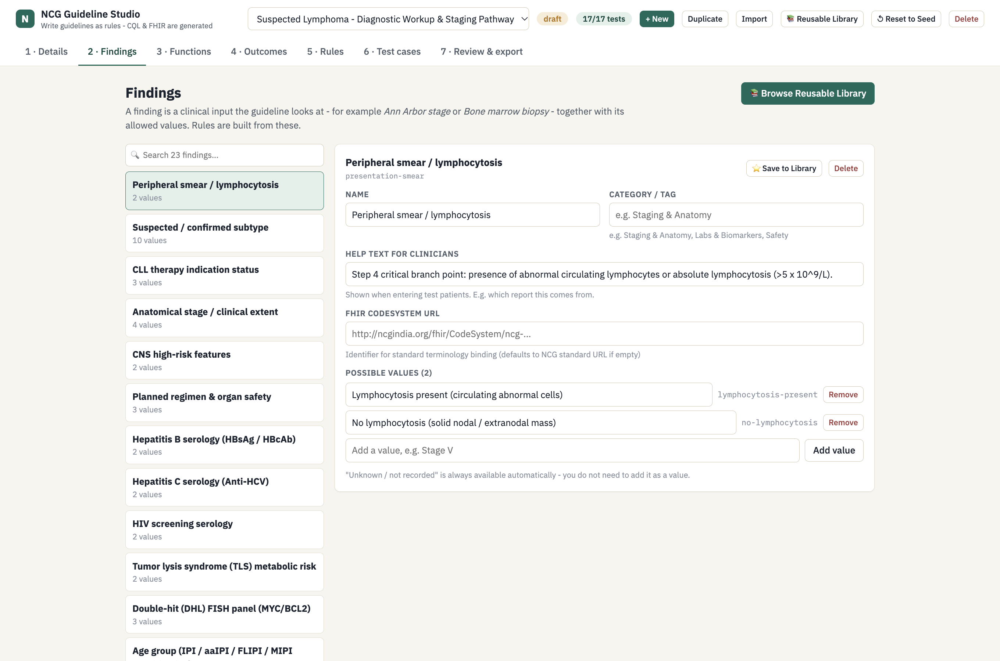

# NCG Guideline Studio (v2) — No-Code Clinical Pathway Authoring

A standalone web authoring environment designed specifically for **medical experts, oncologists, and guideline panels** to create, edit, test, and publish executable, standards-compliant(HL7 CQL) clinical practice guidelines **without writing any code**.

The clinical author only defines findings, treatment outcomes, and decision rules in plain clinical language. The studio automatically generates:
1. **Spec-compliant CQL 1.4 logic libraries** (with automatic data-provenance gates).
2. **FHIR R4 PlanDefinitions and Libraries** ready for EHR Clinical Decision Support (CDS Hooks).
3. **FHIR R4 CodeSystems and ValueSets**.
4. **Interactive Mermaid decision flowcharts**.
5. **Portable Guideline JSON packages** for sharing and revision tracking.

---

## How it works


**NCG Guideline Studio (v2) removes all code dependencies.** A senior oncologist can:
* Click **"+ New"** to start a brand new disease guideline from scratch.
* Define clinical inputs (e.g. *Histology*, *Ann Arbor Stage*, *GELF Burden*, *Fitness*).
* Define treatment groups, regimens, and clinical rationales.
* Build ordered decision rules using a visual **IF ... THEN ...** interface.
* Create synthetic patient test cases and immediately see rule execution traces.
* Toggle the **Safety Gate** to automatically enforce that unparsed referral text routes to a review outcome rather than blindly triggering systemic treatments.

---

## Quick Start

```bash
cd ncg-cql-authoring-mvp-v2
npm install
npm run dev
```

Open [http://localhost:5173](http://localhost:5173) in your browser.

---

## Authoring Workflow & Studio Tour

```
┌───────────┐   ┌────────────┐   ┌────────────┐   ┌─────────┐   ┌────────────┐   ┌─────────────────┐
│ 1 Details │ → │ 2 Findings │ → │ 3 Outcomes │ → │ 4 Rules │ → │ 5 Patients │ → │ 6 Export & CQL │
└───────────┘   └────────────┘   └────────────┘   └─────────┘   └────────────┘   └─────────────────┘
```

### 1 · Details & Clinical Safety Gate
Define the guideline identity, managing oncology working group, citation, and version. The built-in **Data Provenance Safety Gate** can be toggled to automatically guarantee that unvalidated free-text referral data is routed to clinician review instead of inadvertently triggering cytotoxic systemic therapy.


---

### 2 · Clinical Findings
Specify clinical input parameters (e.g., *Histology / Grade*, *Ann Arbor Stage*, *Stage II Contiguity*, *Bone Marrow Biopsy*, *GELF Tumour Burden*, *Fitness for Systemic Therapy*) and configure allowed values with clinical guidance notes.


---

### 3 · Treatment Outcomes & Regimens
Create actionable clinical outcomes categorized into **Treatment**, **Observation / Watchful Waiting**, or **Needs Clinician Review**. Attach regimen shortlists (e.g., *Obinutuzumab + bendamustine*, *R-CHOP*, *ISRT 24 Gy*) and explicit clinical rationales.


---

### 4 · Visual Decision Rules (Top-to-Bottom Ladder)
Construct hierarchical decision logic using an intuitive visual **IF ... THEN ...** rule builder. Rules evaluate top-to-bottom so that safety caveats and specific contraindications execute before broad default treatment pathways.



---

### 5 · Patient Test Bench & Live Verification
Define representative patient cases (e.g., *Stage I limited*, *Advanced high burden*, *Unparsed histology safety test*, *Transformed DLBCL*) and instantly observe evaluation outcomes and full rule execution traces live in the browser.


---

### 6 · Review & Multi-Standard Export
Inspect the generated visual decision flowchart and export standard-compliant clinical artifacts with a single click:
* **Guideline (JSON, shareable)** — Portable document for version control and peer exchange.
* **CQL Library** — Spec-compliant HL7 CQL 1.4 with automated provenance gates.
* **FHIR Library & PlanDefinition** — HL7 FHIR R4 resources ready for CDS Hooks engines.
* **FHIR CodeSystems & ValueSets** — Standardized terminologies for EHR mapping.
* **Flowchart (Mermaid)** — Visual pathway diagram for clinical review.


---


